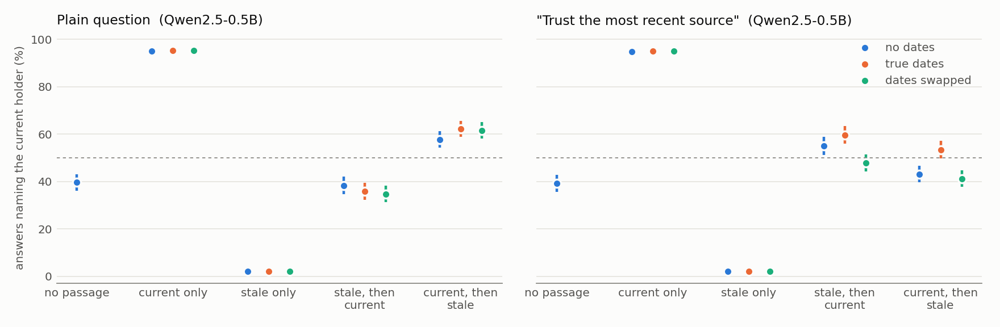
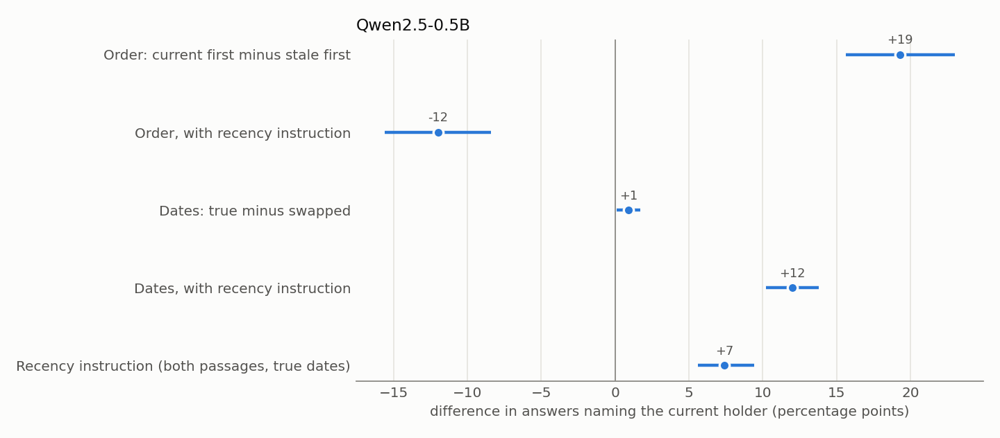

# stale-rag

**Does retrieval-augmented generation notice when a fact is out of date?**

Real RAG corpora are full of passages that were true when written and are wrong now: an old revision, an archived press release, a cached page. This project measures what a reader model does when the retrieved context names a predecessor (the old prime minister, the previous CEO, last season's coach) instead of, or alongside, the person who holds the role today.

## Hypothesis

Readers treat retrieved text as authoritative and mostly ignore when it was written. Concretely:

1. Given only a stale passage, readers repeat the stale answer even when they know the current one from training.
2. Given a stale and a current passage, the answer depends on passage order more than on the dates attached to them.
3. Swapping the two passages' date stamps barely moves the answer. If a model really used dates, labelling the stale passage as newer would pull it toward the old holder.
4. Telling the model today's date and asking it to prefer the newest source helps, but less than it should.

## Data

> The raw inputs are not in this repository. [DATA.md](DATA.md) records exactly which files were used, with sizes and fingerprints, and how to re-fetch them.

Built automatically from public sources, no hand labelling:

- **Facts** (`stale_rag/facts.py`): every dated Wikidata statement for five roles that change hands: head of government (P6), head of state (P35), CEO (P169), head coach (P286) and chairperson (P488). A subject qualifies if it has exactly one current holder and a predecessor whose term ended within a year of the change, the predecessor was already in office on the snapshot date, and the subject is prominent (sitelink threshold per role). Changes run from 2008 to 90 days before the build date.
- **Passages** (`stale_rag/passages.py`): for each fact, the subject's English Wikipedia article is read at two points in time: the revision live 120 days before the change (stale), and today's revision (current). From each, the extractor takes the best window of up to three sentences that names that revision's holder and **does not** name the other one, so the two passages truly disagree. It prefers full-name matches and sentences with present-tense role cues ("incumbent", "currently", "is headed by").

A typical pair (Montana, head of government):

> **stale** (2020): The executive branch is headed by an elected governor. The governor is Steve Bullock, a Democrat elected in 2012.
>
> **current** (2026): The executive branch is headed by an elected governor. The governor is Greg Gianforte, a Republican elected in 2020.

## Design

Every task is crossed with three factors (`stale_rag/conditions.py`), 26 conditions in all:

| factor | levels |
|---|---|
| context | closed-book, current only, stale only, stale then current, current then stale |
| dates | no stamps, true revision dates, dates swapped between the passages |
| instruction | plain question, or "today is X; if sources disagree, trust the most recent" |

Two reader backends (`stale_rag/readers.py`):

- **Local scorer** (any Hugging Face chat model, CPU is fine): the log-probability of each holder's name as the complete answer. This gives a graded preference, not just a hit, and is deterministic.
- **Claude** (`--reader claude`): a short generated answer, matched against each holder's Wikidata name and aliases. Needs `ANTHROPIC_API_KEY`.

### Measures

- `p_new`: share of answers naming the current holder.
- `shift` (local scorer): `lp_new - lp_old` in a condition minus the same fact's closed-book value. This cancels how likely each name is a priori, which otherwise confounds name-scoring.
- **date effect**: `p_new` with true dates minus `p_new` with swapped dates, in the mixed contexts. Near zero means the model ignores dates.
- **cutoff split**: results split by whether the change happened before or after the reader's training cutoff. Before the cutoff the model may already know the answer; after it, the context is its only source.

## Run it

```bash
pip install -r requirements.txt
python -m stale_rag.facts                 # Wikidata -> data/facts.jsonl
python -m stale_rag.passages              # Wikipedia -> data/tasks.jsonl
python -m stale_rag.run --reader hf --model Qwen/Qwen2.5-0.5B-Instruct --limit 200
python -m stale_rag.analyze results/hf__Qwen_Qwen2.5-0.5B-Instruct.jsonl --cutoff 2024-06-01
python -m stale_rag.figures results/hf__Qwen_Qwen2.5-0.5B-Instruct.jsonl
python -m pytest
```

`run_all.sh` runs the full experiment (0.5B on every task, then 1.5B on a seeded 300-task subset). `run.py` appends to its results file and skips finished rows, so it can be stopped and resumed.

All HTTP responses are cached in `data/http_cache/`. Wikimedia rate-limits anonymous API clients, so requests are throttled to one per second; set `STALE_RAG_CONTACT` to an email or URL to identify yourself in the User-Agent. After changing extraction rules, `STALE_RAG_OFFLINE=1 python -m stale_rag.passages` rebuilds the tasks from the cache alone.

## Results

Two readers, scored by log-probability: **Qwen2.5-0.5B-Instruct** on all 725 facts and **Qwen2.5-1.5B-Instruct** on a seeded 300-fact subset, each across all 26 conditions (26,650 scored prompts). The figures and the comparisons below use the 300 facts both models saw; intervals are 95% bootstraps over facts.





1. **One stale passage overrides what the model knows.** Given only the stale passage, the models name the current holder 4% (0.5B) and 5% (1.5B) of the time. With only the current passage, 94% and 93%. The passage decides the answer almost completely.
2. **Knowing the answer helps only the bigger model, and only a little.** Call a fact "known" when, with no passage, the model prefers the current holder by about 150 to 1 or more (log-probability margin above 5): 75 facts for 0.5B, 62 for 1.5B.

   | known minus unknown facts, % naming the current holder | 0.5B | 1.5B |
   |---|---|---|
   | stale passage only | +8 (1 to 15) | **+21 (12 to 32)** |
   | both passages, true dates, plain question | +6 (-4 to 17) | **+18 (7 to 29)** |

   Even so, the 1.5B model gives the stale answer on 78% of the facts it knows when shown only the stale passage. Both models also know older changes better: with no passage they get 44 to 46% of changes up to 2022 against 26 to 32% from 2023 on.
3. **With both passages and a plain question, the first passage wins.** Current-first minus stale-first is **+22 points** (16 to 27) for 0.5B and **+17** (12 to 23) for 1.5B. The gap roughly doubles when both passages state the role in the present tense ("the current governor is..."): 37 against 19 points for 0.5B, 29 against 16 for 1.5B.
4. **Dates are ignored unless the model is told to use them.** With a plain question, swapping the two passages' revision dates moves the answer by **+1** and **+2 points**. With "if the sources disagree, trust the most recent one", true dates beat swapped dates by **+10** (8 to 13) and **+8** (6 to 11).
5. **The small model reads "most recent" as "last".** With no dates at all, the recency instruction flips the 0.5B order effect to **-10 points** (-15 to -5): it pulls the answer toward whichever passage comes second. At 1.5B this is gone (+4, -2 to 10).
6. **Even the best prompt leaves about half the answers stale.** With both passages, true dates and the recency instruction, the models name the current holder 55% (0.5B) and 53% (1.5B) of the time, averaged over the two orders: 5 to 7 points better than the plain question.

On all 725 facts the 0.5B numbers match the subset: order effect +19 (16 to 23), date effect +1 plain and +12 with the instruction, -12 last-passage pull, 2% current with only the stale passage.

**Takeaway.** For these readers, retrieval is close to the whole answer: whatever passage comes first, or comes alone, wins, and an attached revision date only matters when the prompt explicitly asks for it. A RAG system that keeps old versions in its index cannot count on the reader to sort them out; it has to filter or rerank by date before generation. The one sign of resistance, at 1.5B on facts the model already knows, is real but small.

## Limits

- Wikidata succession data is incomplete and sometimes wrong; a fact whose "current" holder has already changed again will be scored against the wrong answer. The 90-day buffer and the one-current-holder rule reduce but do not remove this.
- The extractor works on raw wikitext with a regex stripper. It is deliberately crude, and some passages will read awkwardly.
- The "current" passage can name the new holder in a historical sentence rather than as the incumbent. Cue-word ranking makes this less common.
- Names that are only a short surname, or that share a surname with the other holder, are harder to match and are under-represented.

## License

MIT
